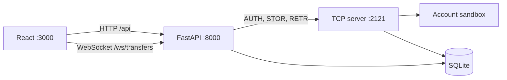
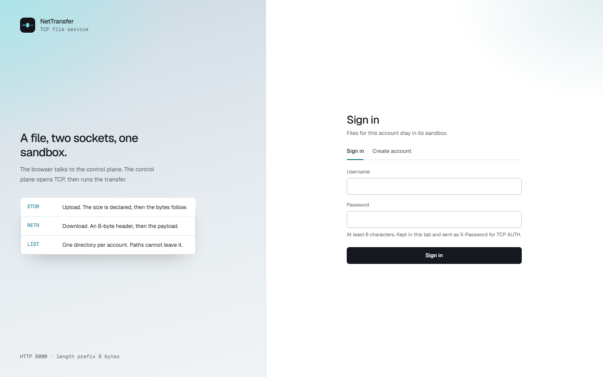
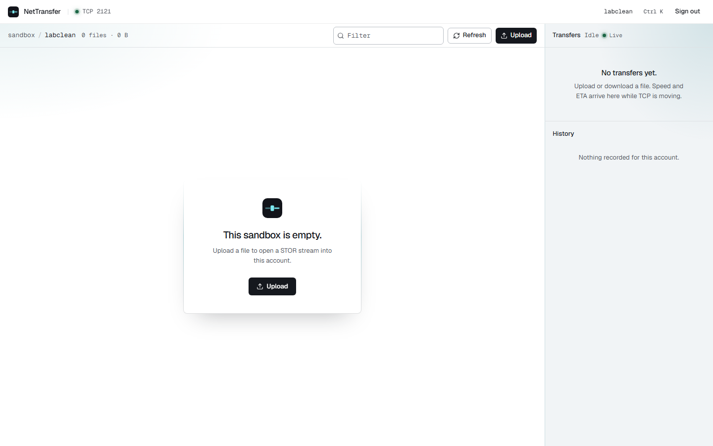
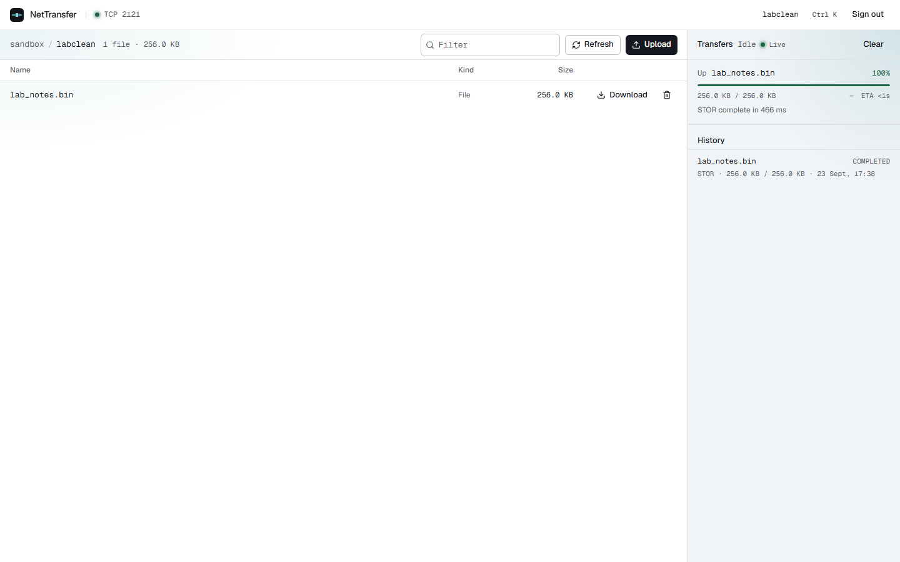
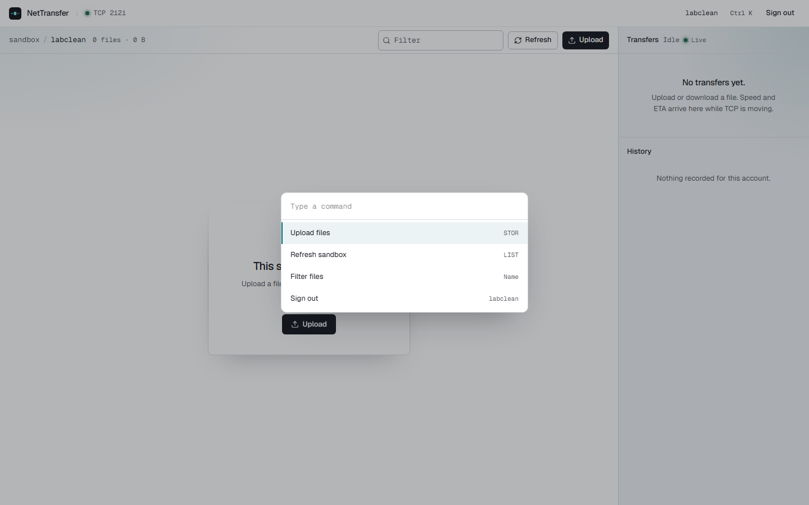
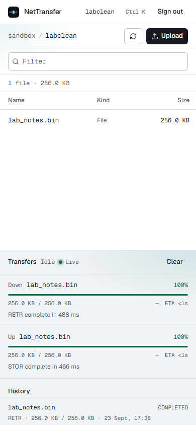
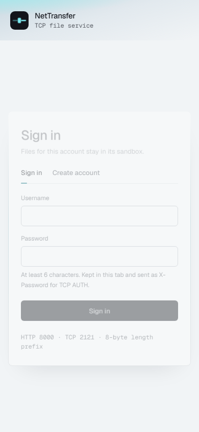

# NetTransfer


The tile in that lockup is the favicon, drawn with the same paths. In the header it stands alone. Here the cyan lead leaves the tile and runs into the name.

A computer-networks lab for moving a file in two hops. The browser speaks HTTP. The control plane opens a raw TCP session, authenticates, and runs `STOR` or `RETR`. Binary bodies on that session start with an 8-byte big-endian length. Each account is one directory, and a path that would leave it is rejected.

> [!IMPORTANT]
> Three processes have to be up, in this order: the TCP server on **2121**, the FastAPI control plane on **8000**, then the web app on **3000**. An upload fails if the TCP server is down, even when the page itself loads.

> [!WARNING]
> This is a localhost lab. There is no TLS. Passwords and file bytes are visible on the wire. Do not put a password you use anywhere else into this app, and do not expose ports 2121 or 8000 past your own machine.



The map of those boxes, the framing, and the Wireshark pass that comes next are in [architecture.md](architecture.md).

## What it looks like

Sign-in. The mark on the left is the same drawing as the favicon.



An empty sandbox. The green dot beside **Live** means the progress socket is open.



After a 256 KiB `STOR`. The card is the TCP result, and History has the row the server stored.



Commands from the keyboard: Ctrl K, or Command K on macOS.



The same shell on a phone width, and the sign-in form there:





Older terminal sessions of the interactive client are in `docs/screenshots/image0.png`, `image1.png`, and `image2.png`.

> [!TIP]
> Recapture the UI shots, with the three processes already running, from `apps/web`:
>
> `node e2e/capture.mjs`
>
> Playwright and its Chromium build are a dev dependency. The first time, run `pnpm exec playwright install chromium`.

## Layout

```text
apps/server/          TCP server, interactive client, FastAPI control plane
apps/web/             React UI
apps/storage/         SQLite database, nettransfer.db
apps/server/storage/users/<account>/    that account's files
```

The TCP server and the HTTP file routes share one sandbox root, resolved in `apps/server/src/storage/layout.py`.

> [!CAUTION]
> Do not point those two processes at different directories. `LIST` on the socket and the file table in the browser will disagree, and an upload will look like it vanished.

## Requirements

- Python 3.11 or newer, with [uv](https://docs.astral.sh/uv/)
- Node.js and pnpm

From `apps/server`:

```text
uv sync
```

From `apps/web`:

```text
pnpm install
```

## Run

**1. TCP server**, port 2121

```text
cd apps/server
uv run python -m src.networking.tcp_server
```

An optional port argument overrides 2121.

**2. Control plane**, port 8000

```text
cd apps/server
uv run uvicorn src.main:app --host 127.0.0.1 --port 8000
```

API docs are at `http://127.0.0.1:8000/docs`. `GET /` is the health check.

**3. Web UI**, port 3000

```text
cd apps/web
pnpm dev
```

Open `http://127.0.0.1:3000`. Vite proxies `/api` and `/ws` to port 8000. Sign-in hands the password to the control plane once. The browser keeps only the token. The process holds the password in memory so it can `AUTH` the TCP session, and drops it on sign-out or when the token expires.

If the light beside `TCP 2121` is red, the control plane did not answer. If that light is green and an upload still fails, the TCP server is the one that is down. The transfer rail has its own light: **Live** means `/ws/transfers` is open.

## TCP protocol

Commands are UTF-8 lines ending in `\n`. Replies use three-digit codes.

| Code | Meaning |
| --- | --- |
| 220 | Banner. `Welcome to NetTransfer TCP Service` |
| 200 | `REGISTER` succeeded |
| 221 | `QUIT` accepted, session closing |
| 230 | `AUTH` succeeded |
| 150 | Ready for a listing or a binary transfer |
| 213 | `SIZE` result |
| 226 | Transfer finished |
| 257 | `PWD` result |
| 501 | Bad syntax or a rejected size |
| 502 | Unknown command |
| 530 | Not authenticated, or bad credentials |
| 550 | Missing file, or username taken |
| 553 | Path left the account sandbox |

Before login: `REGISTER <user> <pass>`, `AUTH <user> <pass>`. After login: `PWD`, `LIST`, `SIZE <filename>`, `STOR <filename> <size>`, `RETR <filename>`. `QUIT` closes the session.

`STOR` declares the byte count, then the sender writes exactly that many raw bytes. `RETR` answers `150`, then an unsigned 64-bit big-endian length (`>Q`, 8 bytes), then the payload, then `226`.

> [!NOTE]
> The last field of `STOR` is the size, so a name may contain spaces: `STOR my notes.bin 4096`. Slashes and `..` are still rejected. The resolved path has to stay inside `storage/users/<account>/`.

`LIST` prints one line per entry, `FILE|name|size` or `DIR|name|size`, then `226`.

Passwords are bcrypt hashes with 12 rounds. The TCP server gives each connection its own thread.

## Interactive client

With the TCP server running:

```text
cd apps/server
uv run python -m src.networking.client
```

Optional arguments are host and port.

```text
REGISTER ada your-password
AUTH ada your-password
PUT path\to\local.bin
LIST
GET sample_payload.bin
PWD
SIZE sample_payload.bin
QUIT
```

`PUT` and `GET` are client helpers. They send `STOR` and `RETR` and print a progress line. Every other line is forwarded as written.

A checked session against this tree: `AUTH`, `LIST` of one file, `GET` of 262144 bytes, then `221` on `QUIT`.

## HTTP control plane

Routes other than auth require `Authorization: Bearer <token>`. Tokens are HS256 and expire after 24 hours. Upload and download use the password remembered at sign-in. A client that does not use that flow can still send `X-Password`.

| Method | Path | Role |
| --- | --- | --- |
| POST | `/api/auth/register` | Create an account and its directory. Body: `{ "username", "password" }` |
| POST | `/api/auth/login` | Same body. Returns `access_token`, `username`, `user_id` |
| GET | `/api/files` | List the account sandbox |
| DELETE | `/api/files/{filename}` | Delete a file. Directories are left in place |
| POST | `/api/transfers/upload` | Multipart field `file`. Spooled, then streamed as `STOR` |
| GET | `/api/transfers/download/{filename}` | `RETR`, then stream the bytes to the browser |
| GET | `/api/transfers/history` | Up to 50 stored transfer rows |
| WS | `/ws/transfers` | Live TCP byte counts, speed, and ETA. The first frame is `{"type":"auth","token":"..."}` |

The browser sends `X-Transfer-Id` so the socket messages land on the card that is already on screen.

Usernames are stored in lowercase and must be at least 3 characters. Passwords must be at least 6.

`STOR` has to be told the size before any payload byte, so the upload is counted first. Up to 1 MiB stays in a memory spool. Anything larger is a temp file, then the bridge streams 64 KiB chunks to TCP. While the browser is still sending the body, the card measures that HTTP hop. Once `STOR` or `RETR` is underway, the numbers on the card are the TCP session.

## Web UI

`apps/web` is React 19 and TypeScript, styled with Tailwind CSS 4. The type is Geist, bundled with the app.

- Sign-in and account creation
- Sandbox breadcrumb, file list, upload, download, delete
- Transfer cards: bytes, speed, ETA, and queued / transferring / completed / failed / cancelled
- Command list on Ctrl K
- A link light for the control plane, and a separate light for the progress socket

```text
cd apps/web
pnpm build
```

`pnpm preview` serves `dist` without the dev proxy. API calls then need the control plane on the same origin, or a proxy of your own.

## Data

SQLite is `apps/storage/nettransfer.db`.

- `users` — id, username, bcrypt hash, created time
- `transfers` — id, user, filename, direction (`UPLOAD` or `DOWNLOAD`), size, bytes transferred, status, start and completion times

Files live in `apps/server/storage/users/<username>/`. HTTP registration creates that directory immediately. TCP `REGISTER` only inserts the user. The directory appears on the next TCP `AUTH`.

## Course milestones

| Milestone | State |
| --- | --- |
| 2. TCP `STOR` / `RETR`, length prefix, chunked IO, path sandbox | In the TCP server and the client |
| 3. SQLite users and transfer records, bcrypt, directory sandbox | Live. Upload and download write transfer rows |
| 4. Speed, ETA, byte counters, transfer states | In `transfer/manager.py`, pushed to the cards |
| 5. FastAPI auth, files, upload, download | Live |
| 6. React sign-in, explorer, upload and download, progress cards | Live |
| 7. WebSockets for live TCP byte progress | Live at `/ws/transfers` |
| 8. Wireshark notes | Not captured yet. The procedure is in [architecture.md](architecture.md) |

## Limits

- No TLS, on purpose until the Wireshark pass. Encrypting port 2121 would hide `AUTH`, `STOR`, and `RETR`.
- If `NETTRANSFER_JWT_SECRET` is unset, the signing key is random for that process and tokens die on restart. Set the variable, at least 32 characters, when a token should outlive the process. See `apps/server/.env.example`.
- The control plane keeps the login password in memory so it can `AUTH` TCP. It is not in the browser and not in SQLite. A restart forgets it, and sign-out deletes it.
- `STOR` still has to know the byte count before the payload, so a large upload is spooled to disk rather than held as one `bytes` object. The TCP write cannot start until that count is known.

Reports go through [SECURITY.md](SECURITY.md). How to change the tree is in [CONTRIBUTING.md](CONTRIBUTING.md).

## License

[MIT](LICENSE). Copyright 2026 NetTransfer contributors.
