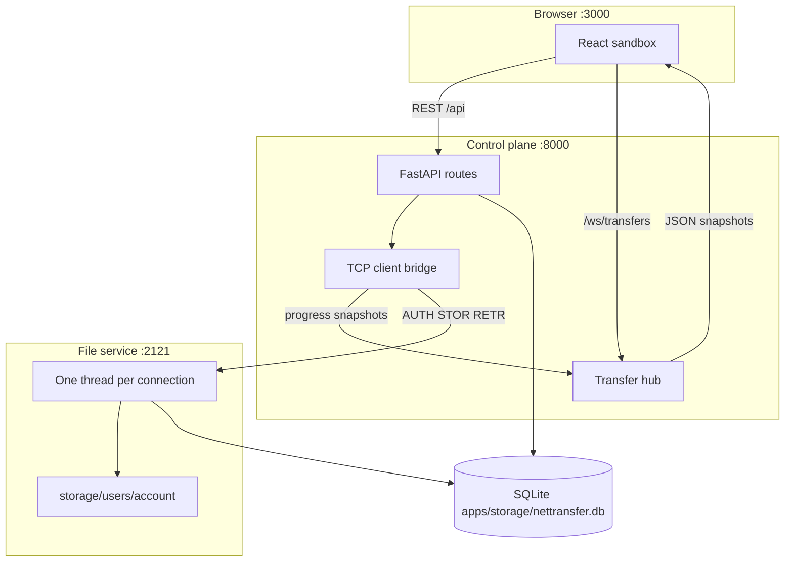
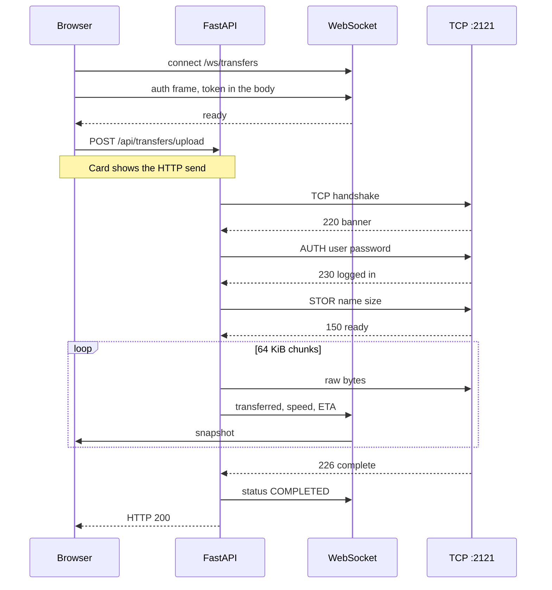
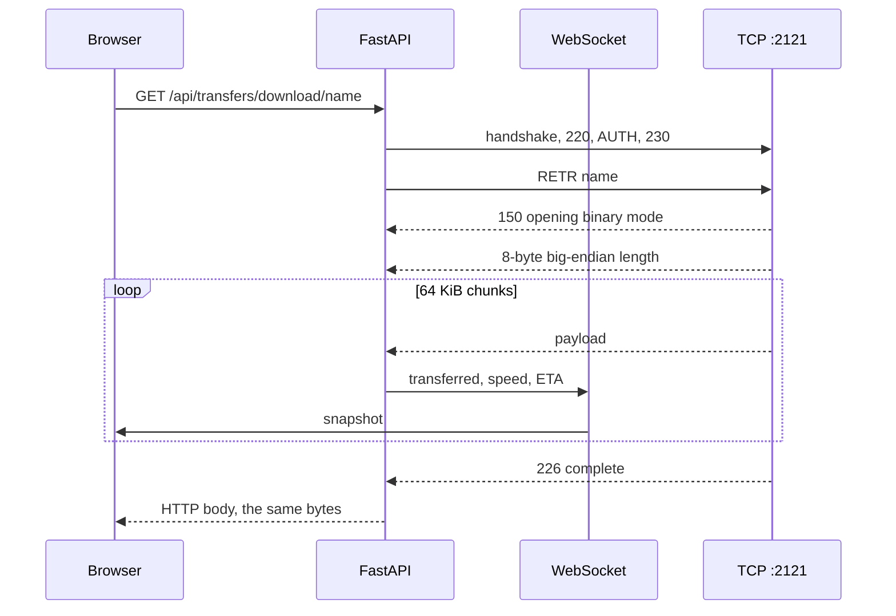

# Architecture

This is the map of NetTransfer after milestone 7 and before the Wireshark write-up. The pieces below are what a capture on loopback should show. Nothing in this file is a substitute for a capture you make yourself.

> [!NOTE]
> Milestone 8 is still yours to perform. The last section is the procedure: which interface, which filters, and which frames are worth keeping.

## The two hops

A file does not go from the browser straight onto the TCP file service. The browser only speaks HTTP and one WebSocket. The control plane is the client of the TCP server.



| Piece | Where | Job |
| --- | --- | --- |
| React UI | `apps/web` | Sign-in, the file table, transfer cards |
| FastAPI | `apps/server/src/api/routes.py` | Auth, listing, upload, download, history |
| Transfer hub | `apps/server/src/api/live.py` | Fan out TCP progress to that user's sockets |
| TCP bridge | `apps/server/src/networking/tcp_client_bridge.py` | One short TCP session per upload or download |
| Framing | `apps/server/src/networking/protocol.py` | Newline commands, 8-byte length prefix |
| TCP server | `apps/server/src/networking/tcp_server.py` | `AUTH`, `LIST`, `STOR`, `RETR`, sandbox |
| Metrics | `apps/server/src/transfer/manager.py` | Bytes, speed, ETA, SQLite row |
| Paths | `apps/server/src/storage/layout.py` | One sandbox root for both processes |

Vite on port 3000 proxies `/api` and `/ws` to port 8000, so the browser treats the page and the API as one origin.

## Upload

The browser measures the HTTP body while it is leaving the machine. The card switches to TCP numbers only after the control plane has the bytes and has opened `STOR`.



`STOR` has no length header of its own. The size was already on the command line. What follows `150` is the file.

## Download

`RETR` is the opposite shape. The size is not on the command. It is the first 8 bytes after `150`.



The control plane holds the payload, then streams it to the browser. On a small file that second hop is short. The interesting counters are the ones that arrived on the socket during `RETR`.

## Framing

| On the wire | Rule |
| --- | --- |
| Commands and replies | One UTF-8 line, `\n` terminated. Replies start with a three-digit code |
| `STOR` body | Exactly `<size>` raw bytes. No extra header |
| `RETR` body | `struct` format `>Q`, then that many bytes |
| Chunk size | 64 KiB in the bridge and in the server |
| Sandbox | Resolved path must stay inside `storage/users/<account>/` |

The last field of `STOR` is the size, so a name may contain spaces. A slash or `..` is rejected.

## Who may see what

> [!IMPORTANT]
> The WebSocket is not a second login. The URL is only `/ws/transfers`. The first text frame is `{"type":"auth","token":"<jwt>"}`, sent after the socket opens, so a proxy access log of the path does not contain the token. A socket only receives snapshots for that user id.

The raw password crosses the TCP session inside `AUTH`. SQLite keeps a bcrypt hash. After HTTP sign-in the control plane holds the password in memory, keyed by the token id, until sign-out or expiry. The browser stores the token, not the password.

There is no TLS on either hop. That is deliberate for the capture in the next section, and it is why both ports stay on loopback.

## Milestone 8 — capturing it in Wireshark

Do this on the machine where the three processes are running. You are looking at your own lab traffic.

1. Start the TCP server, the control plane, and `pnpm dev`, as in the [README](README.md). Sign in so the page is idle before you start the capture. Traffic from a cold start is harder to read.
2. Open Wireshark. Capture on the **loopback** adapter. On Windows that adapter is named **Adapter for loopback traffic capture**, and it has to be installed with Npcap (the loopback option in the Npcap installer). On macOS and Linux, capture on the `lo` interface.
3. Use a display filter so the file service and the control plane are the only conversations:

```text
tcp.port == 2121 || tcp.port == 8000
```

4. Perform one upload of a file you can recognize, then one download of that same file. Stop the capture. Save it as a `.pcapng` next to your notes. Do not commit a capture that contains a real password.

What to mark, in order:

| Moment | Where to look | What you should be able to point at |
| --- | --- | --- |
| TCP handshake | Port 2121 | SYN, SYN-ACK, ACK before any command |
| Banner | First data from the server | The text `220 Welcome to NetTransfer TCP Service` |
| `AUTH` | Next client data | The line `AUTH <user> <password>`, in cleartext |
| `230` | Server data | Login accepted |
| `STOR` | Client data | `STOR <name> <size>`, then raw bytes with no length header |
| `226` | Server data | Transfer complete |
| `RETR` | A second TCP connection | `RETR <name>`, then `150`, then 8 bytes that decode as `>Q`, then the payload |
| Teardown | End of each TCP conversation | FIN/ACK, or RST if a side aborted |
| HTTP hop | Port 8000 | `POST /api/transfers/upload` and `GET /api/transfers/download/...` |
| Progress socket | Port 8000, upgrade | The HTTP request for `/ws/transfers`, status 101, then JSON text frames |

> [!TIP]
> Follow one TCP stream (right-click a port-2121 packet, Follow, TCP Stream) for the file service, and a second stream for port 8000. The file bytes show up twice: once as the `STOR` or `RETR` payload, and once inside the HTTP body. Those are the two hops.

> [!WARNING]
> `AUTH` includes the account password as ASCII. A capture is a secret. Keep it local, and prefer a password you created only for this lab.

> [!TIP]
> Open **Protocol inspector → Wireshark** in the web UI during the capture. It lists the same conversation in Wireshark's column order, with the same client port in `Info`. One difference: the inspector marks the handshake at `accept()` and the close at FIN as single rows, while Wireshark shows each segment. The telemetry link on port 2199 is outside the `2121 || 8000` filter, so it does not clutter the capture.

For the 8-byte header, select the first bytes of server data after the `150` line in a `RETR` stream. Decode them as a big-endian unsigned 64-bit integer. The number has to equal the file size, and the following payload has to be that long before the `226` line.

Write the note as what you observed: one screenshot or a pasted stream for the handshake, one for `STOR`, one for the `RETR` header plus a slice of payload, and one for the FIN teardown. Say which display filter you used. That note is milestone 8. This file stays the map.
